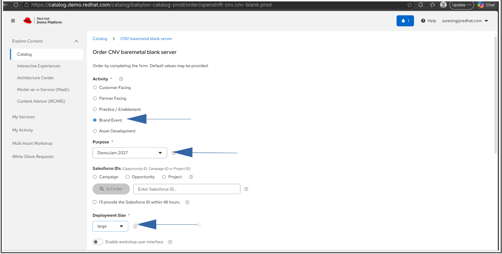
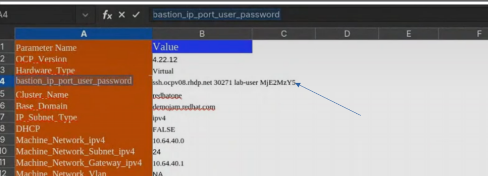
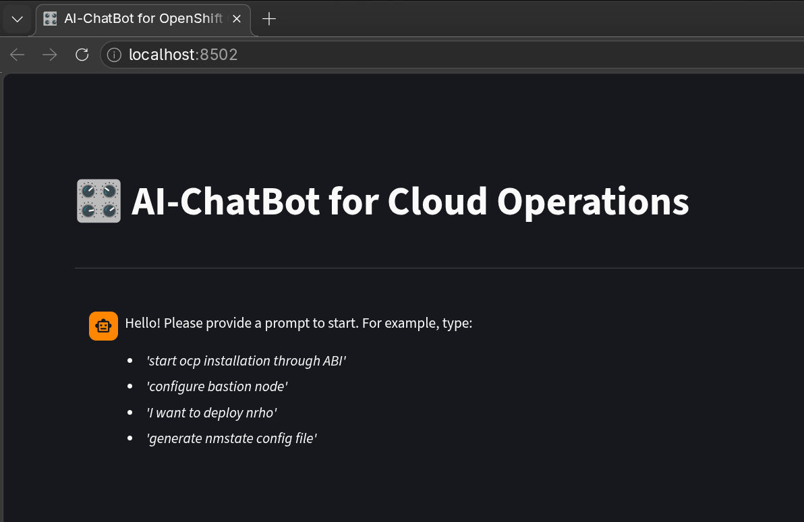
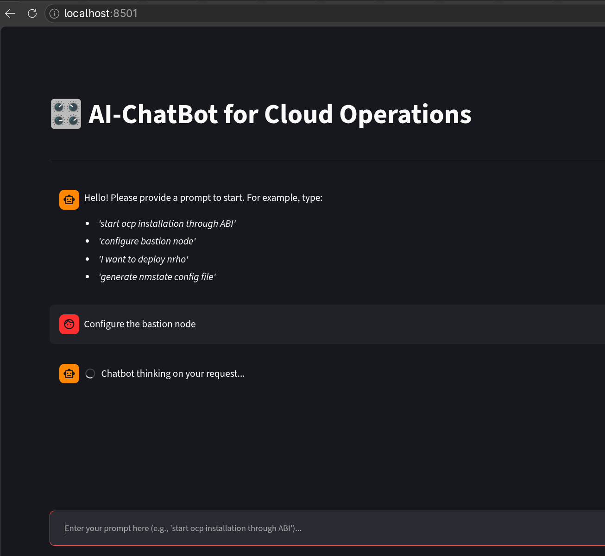
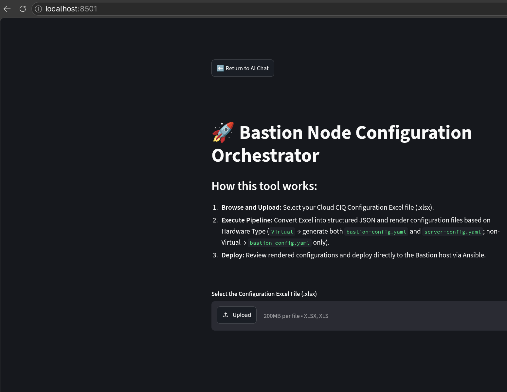
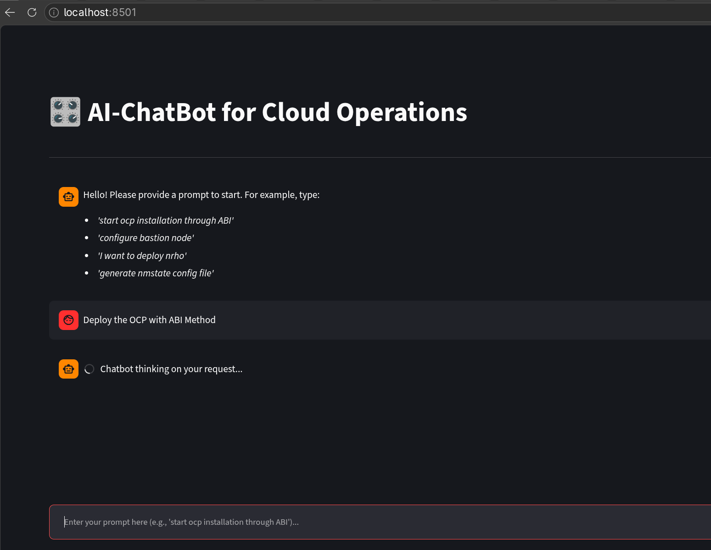
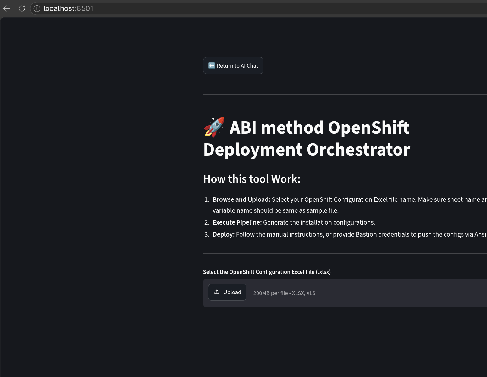

[TOC]

This Document will Help user to test oenshift chatbot AI on demoradhat lab.

# Order the given lab from demo.redhat.com

Order the LAB from [here](https://catalog.demo.redhat.com/catalog/all?search=baremetal&item=babylon-catalog-prod%2Fopenshift-cnv.cnv-blank.prod).


## Select the field as given
 

Download the Code from the given link

```

```
# Configure local server to run OCP AI-Chatbot
install the below software on you local fedor or windows wsl
## Install Puthon utility
```
pip install openpyxl --break-system-packages
pip install streamlit --break-system-packages
```
## Install Ollama on server

### Install Ollama on fedora
```
curl -fsSL https://ollama.com/install.sh | sh
```
### Install Ollama on windows in wsl
```
curl -fsSL https://ollama.com/install.sh | sh
```
### Download the model to run AI-Chatboot
```
ollama run qwen2.5-coder:7b
```

# Start the Demo

## Update the Server Detail in CIQ
update the bastion hostname, port, user and password in CIQ File  Section `bastion_ip_port_user_password`.
 

## Open the Chatboot UI
Go to the AI-Chatbot code folder and run below command, it will Open the AI-ChatBoat UI
```
./ai-chatbot
```
 

## Configure the bastion
Provide the given prompt to AI-Chatbot to configure the Bastion
```
Confiure the Bastion Node
```


It Will select the Bastion Agent to configure the Server for Virtual 3 Node OCP Cluster Deployment

Follow the Instruction for the Bastion Server Configuration

# Install The OCP Cluster
Provide the Prompt to AI-ChatBot for OCP Deployment

```
Deploy the OCP with ABI Method
```


It will Seclet the Agent which will Deploy the OCP with ABI Method


Follow the instruction for the OCP Deployment.


